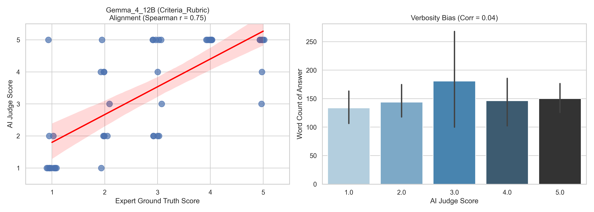
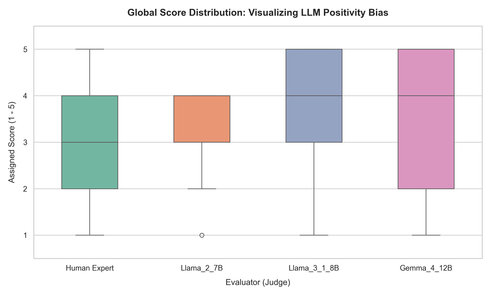

# LLM-as-a-Judge with Local Open-Source Models

Can small, locally hosted open-source LLMs grade AI answers as reliably as human experts?
This project compares three local models as automated judges against human expert ratings.

*University project, NLP course, Master Data Science, FH Technikum Wien (2026).*

## Setup

| | |
|---|---|
| **Judges** | Llama 2 (7B), Llama 3.1 (8B), Gemma 4 (12B) |
| **Hosting** | Fully local via [LM Studio](https://lmstudio.ai/) (OpenAI-compatible API), no data leaves the machine |
| **Data** | 50 cases from the Prometheus Feedback Collection, each with a human expert score (1–5) |
| **Prompt** | Criteria rubric (1–5), injected per case; the judge must answer in JSON (`score` + `reasoning`) |
| **Metrics** | Spearman correlation, weighted Cohen's kappa, length bias (answer length vs. score) |

## Results

| Judge | Spearman r | Weighted kappa | Length bias |
|---|---|---|---|
| Human baseline | 1.00 | 1.00 | 0.110 |
| Llama 2 (7B) | 0.486 | 0.357 | 0.227 |
| Llama 3.1 (8B) | 0.735 | 0.642 | 0.089 |
| **Gemma 4 (12B)** | **0.752** | **0.679** | **0.037** |

- Newer local models (8B–12B) align well with human experts; Llama 2 tends to reward longer answers.
- Gemma 4 shows the highest agreement and almost no length bias.
- The judges tend to score more generously than humans (median 4 for Llama 3.1 and Gemma 4 vs. 3 for the human expert).
  Example: an answer that clearly lacks empathy got 1/5 from the human expert but 3/5 from Llama 2 and Llama 3.1,
  even though both models noticed the missing empathy in their reasoning.




## How to run

1. Install [LM Studio](https://lmstudio.ai/), load one of the models and start the local server (default port 1234).
2. Install dependencies: `pip install -r requirements.txt`
3. Choose the model in `src/judge_pipeline.py` (`ACTIVE_SELECTION`) and run:
   ```
   python src/judge_pipeline.py
   ```
4. After running all models, compute the statistics:
   ```
   python src/analyze_results.py
   ```

Results and plots are written to `results/`. A different server address can be set via the `LM_STUDIO_URL` environment variable.

## Limitations

- Small sample (50 cases) and a single prompt design.
- The discrete 1–5 scale limits how finely judges can distinguish answers.

## Data and license

The subset in `data/` comes from the
[Prometheus Feedback Collection](https://huggingface.co/datasets/prometheus-eval/Feedback-Collection) (CC BY 4.0):
Kim et al. (2023), *Prometheus: Inducing Fine-grained Evaluation Capability in Language Models*, arXiv:2310.08491.
